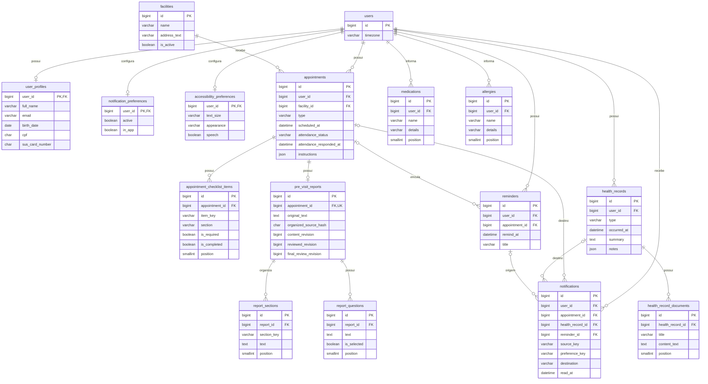

# Proposta de modelagem — V3 Backend + Banco de Dados + CRUD real

**Data:** 8 de outubro de 2026 (America/Sao_Paulo).

**Estado:** modelagem aprovada em 9 de outubro de 2026, com as decisões oficiais incorporadas. Somente a Fase 1 de infraestrutura foi autorizada.

**Base inspecionada:** checkout `523aeda`, posterior ao checkpoint V2 (`28afb398`, commit da tag anotada `V2`). As diferenças posteriores à tag incluem PWA e componentes de escrita/ajuda; a análise considera os formulários atuais.

**Histórico:** a entrega original de 8/10 foi somente documental. A autorização posterior de 9/10 permite criar backend, modelos, migration, seed separado e `/health`, sem CRUD, integração Flutter ou Render. A execução está descrita em [Relatório da infraestrutura V3](../../chega_junto_backend/docs/RELATORIO_INFRAESTRUTURA_V3.md).

## 1. Resumo da arquitetura escolhida

```text
Flutter Android / Flutter Web (inclusive navegador no iPhone)
                         │ HTTPS / REST / JSON
                         ▼
               Python + FastAPI — Render (futuro)
                Pydantic → services → repositories
                         │ SQLAlchemy + driver MySQL + TLS
                         ▼
                     MySQL — Aiven
                         ▲
                  migrations Alembic
```

Desenvolvimento primeiro com FastAPI local conectado ao Aiven; publicação no Render somente depois de validar módulos e integração. Flutter nunca acessa MySQL e recebe somente a URL pública da API. Senha do banco e futura chave de IA ficam exclusivamente no backend.

**Recomendação:** 16 tabelas, PK `BIGINT UNSIGNED AUTO_INCREMENT` nas entidades e PK/FK compartilhada nos três recursos 1:1 de usuário. Sem tabela de percentual de preparo, catálogo clínico, catálogo global de checklist, infraestrutura push, arquivos de áudio ou autenticação implementada. Estados discretos serão strings validadas por Pydantic e pelos serviços, com constraints quando suportadas pela versão MySQL selecionada.

As 16 tabelas são: `users`, `user_profiles`, `facilities`, `appointments`, `appointment_checklist_items`, `reminders`, `medications`, `allergies`, `health_records`, `health_record_documents`, `pre_visit_reports`, `report_sections`, `report_questions`, `notifications`, `notification_preferences`, `accessibility_preferences`.

O contrato inicial aprovado tem **30 operações HTTP: 29 sob `/api/v1/` e uma `/health`**. As cinco expansões sem fluxo na V2 foram adiadas e aparecem separadamente na seção 10. Somente `/health` será funcional na Fase 1. Organização e transcrição reais são extensões posteriores, fora dessa contagem.

### Identificadores: decisão explicitamente aprovada

| Alternativa | Vantagens | Desvantagens | Adequação atual |
| --- | --- | --- | --- |
| BIGINT auto increment | Índices compactos (8 bytes), joins simples, geração centralizada, bom encaixe no SQLAlchemy/MySQL | IDs enumeráveis; cliente precisa receber o ID após criar; importações entre bancos exigem remapeamento | **Recomendado:** um backend, um banco, sem sincronização offline nem criação distribuída |
| UUID | Geração distribuída, melhor encaixe em sincronização offline, menor exposição da sequência | Maior armazenamento/índices; `CHAR(36)` custa mais que `BINARY(16)`; conversão binária e estratégia de ordenação exigem decisões adicionais | Reavaliar se houver offline com sincronização ou múltiplos produtores independentes |

Não recomendar PK híbrida BIGINT + UUID agora. UUID não substitui autorização. Na API, serializar IDs BIGINT como **strings decimais**, preservando o uso de `String` no Dart e evitando perda de precisão numérica na Web. Os IDs legíveis dos mocks não serão PK do banco: fixtures terão um mapa determinístico de IDs antigos para novos. IDs temporários de rascunho permanecem locais até a resposta de criação/salvamento.

## 2. Inventário dos dados atualmente utilizados no Flutter

### 2.1 Fontes examinadas e alcance

A árvore `lib/` contém 81 arquivos Dart, incluindo 22 páginas: 21 telas de produto e processamento transitório. Foram examinados modelos, todos os contratos/mocks, os controllers, composição da sessão, rotas, páginas/formulários e componentes relacionados ao estado. Também foram consultados os testes de regras de relato/revisão/preparo e os documentos de contexto e decisões. Esta etapa faz análise estática; não afirma nova execução da suíte ou dos builds.

Fontes principais (links relativos a este documento):

| Fonte | Evidência de domínio |
| --- | --- |
| [Models](../lib/data/models/) | Estruturas Dart, enums, listas e valores derivados |
| [Repositories](../lib/data/repositories/) | Três contratos: autenticação demonstrativa, preparo e perfil |
| [Mocks](../lib/data/mock/) | Três atendimentos, sete itens de checklist, um lembrete inicial, perfil, quatro medicamentos, três alergias, seis registros históricos, organização e áudio simulados |
| [PreparationController](../lib/core/state/preparation_controller.dart) | Carregamento compartilhado, alterações de checklist/presença, salvamento de relato e serialização da revisão final |
| [ReportController](../lib/core/state/report_controller.dart) | Original, texto processado, transcrição, seções, seleção/ordem de perguntas, versão local e invalidação da revisão |
| [ProfileController](../lib/core/state/profile_controller.dart) | Perfil/saúde via repository; preferências e IDs lidos apenas em memória, sem repository |
| [Composição do app](../lib/app/app.dart) e [rotas](../lib/app/router/app_router.dart) | Injeção de repositories/serviços; controllers duram a sessão; rotas de preparo fixadas à consulta demo |
| [Telas e formulários](../lib/features/) | Pontos reais de leitura, edição, salvamento, exclusão e navegação |
| [Teste da revisão final](../test/final_review_controller_test.dart) e [teste do relato](../test/report_controller_test.dart) | Confirmação das regras de edição, exclusão, concorrência local e conclusão |
| [Decisões V2](IMPLEMENTATION_DECISIONS.md) e [checkpoint V2](RELATORIO_V2_MVP_FUNCIONAL_2026-10-08.md) | Fluxo aprovado, macroetapas e limites demonstrativos |

Documentos antigos de contexto ainda deixam backend em aberto e citam funcionalidades hipotéticas. A stack e o escopo informados nesta solicitação prevalecem. Não se inferem tabelas a partir de funcionalidades apenas planejadas nesses textos.

### 2.2 Inventário por objeto e estado

| Objeto/fonte atual | Dados efetivamente usados | Persistência futura / observações |
| --- | --- | --- |
| `UserProfile` | Nome, email, telefone, número SUS, nascimento, CPF, CEP, rua, número, complemento, bairro, cidade/UF, nome/relação/telefone de emergência | `user_profiles`; um endereço e um contato atuais, sem listas ou compartilhamento entre pessoas |
| `Appointment` | ID, título, especialidade, profissional/equipe em texto, data/hora, unidade, endereço, orientações ordenadas, resposta de presença, tipo consulta/exame | `appointments` + `facilities`; não existe status clínico de realização no model |
| `ChecklistItem` | ID, título, obrigatório, marcado, seção (`documents`, `reminders`, `conversation`) | Itens próprios de cada atendimento; as seções não são lembretes agendados |
| `AppointmentReminder` / `ReminderTiming` | ID, título, data/hora, consulta opcional; opções um dia antes, duas horas antes ou no horário | `reminders`; inicial sem consulta; novos registros vinculados ao próximo atendimento; sem disparo de alarme |
| `PreparationOverview` | Primeiro nome, próximo atendimento, checklist, relato, conjunto de macroetapas, texto auxiliar de lembrete, data fictícia de referência | DTO agregado, não tabela; nome vem do perfil, próximo atendimento por ordenação; texto auxiliar pode derivar do checklist |
| `PreparationProgress` | Conjunto de quatro etapas, contagem, fração e percentual | Derivado dos fatos e marcos; não persistir `75` ou `100` |
| `PreVisitReport` | Appointment ID, original, updatedAt, resumo achatado opcional, lista de textos de perguntas selecionadas | Contrato atual perde estrutura/seleções negativas; banco deve preservar a estrutura do controller |
| `ReportController` / `OrganizedReport` | Original, `processedText`, transcrição editável, seções com ID/título/texto, perguntas com ID/texto/selected/ordem, reviewed, revisão local | `pre_visit_reports`, `report_sections`, `report_questions`; estados de request/gravação continuam transitórios |
| `HealthItem` / `HealthOverview` | Medicamentos e alergias com ID, nome e detalhes livres; histórico separado | `medications` e `allergies`; não analisar dose/frequência nem reação clinicamente |
| `HealthRecord` | Tipo, ocorrência, título, subtítulo, profissional/unidade textuais, motivo, resumo, lista de notas, documentos com título/conteúdo | `health_records` + `health_record_documents`; histórico preexistente independente da agenda |
| `AppNotification` / `demoNotifications()` | ID estável, título, mensagem, data, categoria visual, destino/ID opcional, unread inicial | `notifications`; hoje a lista é reconstruída de preparo/agenda/lembretes; não há repository de notificações |
| `ProfileController._readNotifications` | Set de IDs lidos | Substituir futuramente por `notifications.read_at` |
| `NotificationPreferences` | active, appointments, exams, medications, documents, confirmations, system, inApp | Uma linha em `notification_preferences`; todas começam true, exceto system |
| `AccessibilityPreferences` | textSize, appearance, highContrast, speech, descriptions, simpleLanguage, haptics, reduceMotion | Uma linha em `accessibility_preferences`; preferências do usuário, capacidades do aparelho continuam locais |
| `DemoSession` / `AuthRepository` | Boolean signedIn; `signInDemo()` sem parâmetros | Não há usuário autenticado, senha persistida, token, OAuth Google ou recuperação real |
| `SpeechController` / engines | speaking, erro, cancelamento, seleção de voz local | Nenhuma tabela de áudio/TTS; leitura real local é distinta da gravação simulada |

### 2.3 Telas, formulários e ações verificadas

| Telas / componente | Leituras e gravações atuais |
| --- | --- |
| Boas-vindas, Login | Conteúdo local; email/CPF e senha são entradas transitórias, não enviadas ao mock; Google/cadastro/recuperação são demonstração |
| Home | Perfil, próximo atendimento, progresso, lembrete textual auxiliar e badge de notificações visíveis não lidas |
| Agenda, Novo Lembrete | Mescla atendimentos/lembretes, ordena, busca e filtra Hoje/Próximos/tipos; cria lembrete só ao salvar; não edita nem exclui lembrete hoje |
| Detalhes | Dados do atendimento/unidade, orientações; documentos do checklist e ações de preparo apenas para a próxima consulta; mapa é ilustração e copiar endereço é local |
| Checklist | Toggle grava imediatamente no repository; Concluir só retorna, não marca tudo; apenas obrigatórios alteram seu percentual |
| Presença | Rascunho de seleção local; grava somente em Salvar; Responder depois não grava; orientações não cancelam/remarcam nem avisam unidade |
| Relato, Áudio, Processamento | Texto compartilhado; contador visual de 500 não trunca; áudio sem microfone; transcrição só se incorpora por ação explícita; cancelamento ignora resposta tardia |
| Resumo, Perguntas, Revisão final | Edição/remoção de conteúdo; perguntas selecionáveis, editáveis, adicionáveis, removíveis e reordenáveis; concluir exige resumo atual, aceita zero perguntas e não conclui outras etapas |
| Perfil, Dados pessoais | Um formulário agregado: pessoais/endereço/emergência; sair sem salvar descarta rascunho. Todos os campos editáveis exigem preenchimento salvo complemento; valida formato, não CPF oficial/SUS |
| Medicamentos e alergias | Rascunho de duas listas; nome até 80 e detalhes até 160 caracteres; incluir/editar/remover fica local até Salvar alterações, que grava ambas juntas |
| Histórico, Detalhes do histórico | Somente leitura, filtros, notas e prévias textuais de documentos; não são PDFs reais nem resultados interpretados |
| Notificações, Configurações | Leitura marca ID local; categorias/filtros; preferências imediatas; chave geral e inApp ocultam avisos, sem apagar dados |
| Acessibilidade, Ajuda | Preferências imediatas; FAQ/tutoriais/busca locais, voz local e diálogos; não há tickets, CMS ou suporte externo |

Nascimento hoje compara contra `07/10/2026` no formulário. A API futura deve usar a data corrente no fuso adequado, sem transportar a data fictícia para validação real. CPF/CEP/telefones são strings formatadas na UI; normalizar somente dígitos no contrato/banco quando apropriado. Cidade/UF é um único campo atual: separar na API por adaptador validado, sem alterar a tela nesta fase.

### 2.4 Limitações que afetam os contratos futuros

1. Há três atendimentos na agenda, mas o preparo mutável existe apenas para `consulta-demo-01`. Generalizar preparo por atendimento é uma evolução necessária, não comportamento já disponível.
2. `ReportController._initialize()` restaura somente o texto original; não reidrata seções e perguntas salvas. Mantê-lo vivo mascara essa limitação durante a sessão.
3. `saveReportReview()` achata seções e descarta perguntas desmarcadas. A API não deve adotar esse formato como armazenamento oficial.
4. `PreparationStage.report` começa concluída no seed e `saveReport()` não a recalcula; apagar/alterar conteúdo não mantém essa etapa semanticamente sincronizada. A regra V3 aprovada usa original não vazio (seção 7).
5. Preferências e leitura não passam por `ProfileRepository`; `HomePage` e `NotificationsPage` importam diretamente `mock_notifications.dart`. Injeção existente ajuda, mas não resolve esses pontos sozinha.
6. `invalidateFinalReview()` mantém invalidação local mesmo se o repository falhar. Na rede será necessário confirmar/reconciliar esse estado com o servidor.
7. O histórico de 06/10 e a consulta de 09/10 são eventos distintos; medicamentos/alergias atuais não geram histórico automaticamente.

## 3. Entidades propostas

### 3.1 Convenções do dicionário

- MySQL com InnoDB e `utf8mb4`; collation de textos humanos a fixar na versão alvo. Códigos e hashes terão comparação exata, sem equivalência por maiúsculas/acentos.
- `NN` = `NOT NULL`; `NULL` = opcional. Campo sem indicação de unique não é único. `UQ(...)` representa constraint composta, não unicidade individual.
- **T**, presente em **todas as 16 tabelas**: `created_at DATETIME(6) NN` e `updated_at DATETIME(6) NN`. Instantes UTC preenchidos pelo backend via ORM, sem triggers/defaults SQL; inserções SQL diretas devem fornecê-los. `updated_at` muda em mutação efetiva; serviços futuros também atualizarão o pai quando apenas filhos mudarem. Esses dois campos estão incluídos implicitamente em cada quadro abaixo.
- PK `id`: `BIGINT UNSIGNED NN AUTO_INCREMENT`. FKs usam o mesmo tipo unsigned. Exceção: `user_profiles`, `notification_preferences` e `accessibility_preferences` usam `user_id` como PK/FK, sem outro `id`.
- Boolean: `BOOLEAN` (equivalente MySQL a `TINYINT(1)`); validar somente 0/1. Listas JSON são sempre arrays tipados e ordenados, nunca texto serializado dentro de string.
- Nascimento é `DATE`; instantes são `DATETIME(6)` UTC. `timezone` guarda zona IANA para exibição e agenda, inicialmente `America/Sao_Paulo`. JSON da API usa ISO 8601 com offset/Z; não aceitar datas ambíguas sem fuso.
- Não há `deleted_at` na proposta inicial. Remoções e retenção são especificadas na seção 6.

### 3.2 `users`

**Propósito:** raiz de propriedade dos dados; não é implementação de autenticação.

| Campo | MySQL | Nulabilidade | Chaves / regra |
| --- | --- | --- | --- |
| id | BIGINT UNSIGNED | NN | PK, auto increment |
| timezone | VARCHAR(64) | NN | Default `America/Sao_Paulo`, zona validada |
| T | DATETIME(6), dois campos | NN | Convenção acima |

Sem login, password_hash, tokens ou identificadores OAuth agora. Criar a raiz e os recursos 1:1 na mesma transação de fixture/provisionamento futuro. Não oferecer CRUD público de contas sem escopo de autenticação aprovado.

### 3.3 `user_profiles`

**Propósito:** informações de exibição/contato do único titular, seu endereço atual e único contato de emergência.

| Campo | MySQL | Nulabilidade | Chaves / regra |
| --- | --- | --- | --- |
| user_id | BIGINT UNSIGNED | NN | PK e FK → users.id; garante no máximo um perfil |
| full_name | VARCHAR(160) | NN | Não vazio |
| email | VARCHAR(254) | NN | Contato, **sem unique** enquanto não for identidade de login |
| phone | VARCHAR(20) | NN | Dígitos; formato brasileiro atual |
| sus_card_number | CHAR(15) | NULL | Dígitos; só leitura na V2; sem unique/verificação externa |
| birth_date | DATE | NN | Sem horário; não futura |
| cpf | CHAR(11) | NN | Dígitos; sem unique/validação cadastral oficial |
| postcode | CHAR(8) | NN | Dígitos |
| street | VARCHAR(200) | NN | Não vazio |
| number | VARCHAR(20) | NN | Aceita valores textuais, não converter para inteiro |
| complement | VARCHAR(100) | NULL | Ausência vira null |
| neighborhood | VARCHAR(100) | NN | Não vazio |
| city | VARCHAR(100) | NN | Cidade sem UF |
| state_code | CHAR(2) | NN | UF validada, separada do campo visual Cidade / UF |
| emergency_name | VARCHAR(160) | NN | Um contato atual |
| emergency_relationship | VARCHAR(80) | NN | Texto livre |
| emergency_phone | VARCHAR(20) | NN | Dígitos |
| T | DATETIME(6), dois campos | NN | Convenção acima |

Obrigatoriedade segue o formulário atual; cadastro incompleto futuro exigirá rever nulabilidade. Email de contato não deve virar automaticamente identificador autenticado. Campos SUS são opcionais para não exigir dado que não tem edição atual. Nenhuma unidade de referência é FK do perfil: hoje o cartão apenas exibe a unidade da próxima consulta.

### 3.4 `facilities`

**Propósito:** reutilizar unidade/local entre atendimentos, como UBS Centro e Laboratório Municipal.

| Campo | MySQL | Nulabilidade | Chaves / regra |
| --- | --- | --- | --- |
| id | BIGINT UNSIGNED | NN | PK |
| name | VARCHAR(160) | NN | Sem unique: nomes podem repetir |
| address_text | VARCHAR(500) | NN | Endereço de exibição já existente, sem geocodificação |
| is_active | BOOLEAN | NN | Default true; inativar sem quebrar atendimentos |
| T | DATETIME(6), dois campos | NN | Convenção acima |

Sem cadastro de profissionais/CNES, latitude, rotas ou contato oficial inventado. Alterar endereço muda a referência dos atendimentos; registros históricos usam snapshot textual próprio (seção 3.9). Preservar endereço antigo de agendamento demandaria snapshot adicional, hoje pendente de necessidade.

### 3.5 `appointments`

**Propósito:** consulta ou exame registrado na agenda pessoal, com uma resposta atual de intenção de comparecimento.

| Campo | MySQL | Nulabilidade | Chaves / regra |
| --- | --- | --- | --- |
| id | BIGINT UNSIGNED | NN | PK |
| user_id | BIGINT UNSIGNED | NN | FK → users.id |
| facility_id | BIGINT UNSIGNED | NN | FK → facilities.id |
| type | VARCHAR(20) | NN | `consultation`, `exam` |
| title | VARCHAR(160) | NN | Não vazio |
| specialty | VARCHAR(120) | NN | Texto, não catálogo médico |
| professional_name | VARCHAR(160) | NN | Também comporta equipe do laboratório |
| scheduled_at | DATETIME(6) | NN | UTC; indexar (user_id, scheduled_at) |
| timezone | VARCHAR(64) | NN | Fuso do atendimento; default inicial São Paulo |
| instructions | JSON | NN | Array ordenado de strings, pode ser vazio |
| attendance_status | VARCHAR(20) | NN | Default `undecided`; `confirmed`, `undecided`, `unable` |
| attendance_responded_at | DATETIME(6) | NULL | null = ainda não houve salvamento explícito; distingue resposta indecisa |
| T | DATETIME(6), dois campos | NN | Convenção acima |

Sem `status=completed/cancelled` inicial: a V2 não registra realização ou cancelamento. Não inferir realizado quando a data passa. `unable` é intenção, **não cancelamento**. Não há `attendance_confirmations`: só uma resposta atual, sem histórico de tentativas ou mensagens. Esse subrecurso terá GET/PUT, mas compartilha a tabela de atendimento.

### 3.6 `appointment_checklist_items`

**Propósito:** itens e marcações específicos de um atendimento; dispensa catálogo global e tabela de junção.

| Campo | MySQL | Nulabilidade | Chaves / regra |
| --- | --- | --- | --- |
| id | BIGINT UNSIGNED | NN | PK |
| appointment_id | BIGINT UNSIGNED | NN | FK → appointments.id |
| item_key | VARCHAR(64) | NN | Chave de fixture/negócio; UQ(appointment_id, item_key) |
| title | VARCHAR(200) | NN | Conteúdo próprio do atendimento |
| section | VARCHAR(20) | NN | `documents`, `reminders`, `conversation` |
| is_required | BOOLEAN | NN | Define cálculo; default false |
| is_completed | BOOLEAN | NN | Estado real da marcação; default false |
| position | SMALLINT UNSIGNED | NN | Ordem; UQ(appointment_id, position) |
| T | DATETIME(6), dois campos | NN | Convenção acima |

Sem `completed_at` obrigatório: não há demanda de auditoria da marcação. `is_completed` basta; `updated_at` registra a última alteração. Não vincular a arquivos nem tratar itens opcionais como obrigatórios. Item `medicamentos` do checklist é uma instrução textual, não FK para um medicamento.

### 3.7 `reminders`

**Propósito:** lembrete na agenda pessoal, possivelmente relacionado a consulta/exame, sem mecanismo de entrega.

| Campo | MySQL | Nulabilidade | Chaves / regra |
| --- | --- | --- | --- |
| id | BIGINT UNSIGNED | NN | PK |
| user_id | BIGINT UNSIGNED | NN | FK → users.id |
| appointment_id | BIGINT UNSIGNED | NULL | FK → appointments.id, do mesmo titular |
| title | VARCHAR(80) | NN | Não vazio, limite do formulário |
| remind_at | DATETIME(6) | NN | UTC; indexar (user_id, remind_at) |
| T | DATETIME(6), dois campos | NN | Convenção acima |

Data/hora é necessária e já existe; vínculo opcional preserva o lembrete inicial. **Sem status** por enquanto: não há concluir/cancelar/disparar no fluxo atual. Não chamar um lembrete de enviado ao passar a hora. As três antecipações são opções de UI para calcular `remind_at`; não precisam ser tabela ou coluna. Recomendação inicial: horário absoluto salvo, como V2; acompanhar remarcações automaticamente exigiria persistir offset e aprovar nova regra.

### 3.8 `medications` e `allergies` (duas entidades)

**Propósito:** listas pessoais atuais com informações fornecidas pelo titular. Não são catálogo de medicamentos, prescrição nem classificação de alergia.

Cada uma das duas tabelas possui o seguinte dicionário:

| Campo | MySQL | Nulabilidade | Chaves / regra |
| --- | --- | --- | --- |
| id | BIGINT UNSIGNED | NN | PK independente em cada tabela |
| user_id | BIGINT UNSIGNED | NN | FK → users.id |
| name | VARCHAR(80) | NN | Não vazio; sem unique |
| details | VARCHAR(160) | NN | Uso informado / reação informada; texto livre |
| position | SMALLINT UNSIGNED | NN | Ordem atual; UQ(user_id, position) em cada tabela |
| T | DATETIME(6), dois campos | NN | Convenção acima |

Não decompor “50 mg • 1x ao dia” em dose, via e frequência: o formulário aceita qualquer texto e não oferece validação clínica. Duplicação de nome não prova duplicação do registro. Excluir da lista não apaga nem reescreve um registro histórico independente.

### 3.9 `health_records`

**Propósito:** registro pessoal de evento anterior, independente da agenda e das listas de saúde atuais.

| Campo | MySQL | Nulabilidade | Chaves / regra |
| --- | --- | --- | --- |
| id | BIGINT UNSIGNED | NN | PK |
| user_id | BIGINT UNSIGNED | NN | FK → users.id |
| type | VARCHAR(24) | NN | `consultation`, `exam`, `medication`, `allergy`, `diagnosis` |
| occurred_at | DATETIME(6) | NN | UTC; indexar (user_id, occurred_at) |
| title | VARCHAR(200) | NN | Não vazio |
| subtitle | VARCHAR(250) | NN | Descrição histórica própria, não sempre derivável |
| professional_text | VARCHAR(160) | NULL | Snapshot; vazio do model vira null |
| facility_text | VARCHAR(160) | NULL | Snapshot; não exigir unidade ainda cadastrada |
| reason | TEXT | NN | Texto informado/preexistente |
| summary | MEDIUMTEXT | NN | Resumo histórico, não resumo produzido por IA clínica |
| notes | JSON | NN | Array ordenado de strings; default lógico [] |
| T | DATETIME(6), dois campos | NN | Convenção acima |

Sem FK obrigatória para appointment/medication/allergy/facility: o código não fornece essas identidades e não autoriza deduzi-las por nome. `diagnosis` conserva apenas a categoria histórica já existente; **não há diagnóstico gerado** nem endpoint para IA preencher histórico. Sem segunda tabela `health_history`: ela seria apenas duplicação da coleção de registros.

### 3.10 `health_record_documents`

**Propósito:** prévias textuais associadas a um registro histórico; identidade e ordenação explícitas para leitura de cada documento.

| Campo | MySQL | Nulabilidade | Chaves / regra |
| --- | --- | --- | --- |
| id | BIGINT UNSIGNED | NN | PK |
| health_record_id | BIGINT UNSIGNED | NN | FK → health_records.id |
| title | VARCHAR(200) | NN | Sem unique |
| content_text | MEDIUMTEXT | NN | Conteúdo textual demonstrativo |
| position | SMALLINT UNSIGNED | NN | UQ(health_record_id, position) |
| T | DATETIME(6), dois campos | NN | Convenção acima |

Não há blob, URL de upload, object storage, laudo interpretado ou PDF real. Nenhuma relação com as marcações de documentos do checklist. O GET do histórico pode embutir essas prévias; não precisa endpoint separado por documento no MVP.

### 3.11 `pre_visit_reports`

**Propósito:** um relato atual por atendimento, com marcos de organização/revisão e controle de concorrência; sem guardar versões históricas completas.

| Campo | MySQL | Nulabilidade | Chaves / regra |
| --- | --- | --- | --- |
| id | BIGINT UNSIGNED | NN | PK |
| appointment_id | BIGINT UNSIGNED | NN | FK → appointments.id; **UNIQUE** |
| original_text | MEDIUMTEXT | NN | Default lógico vazio; manter texto integral |
| organized_source_hash | CHAR(64) | NULL | SHA-256 do original exato usado para organizar; comparação binária |
| organized_at | DATETIME(6) | NULL | Marco de organização; não prova revisão humana |
| content_revision | BIGINT UNSIGNED | NN | Inicia em 1; incrementa apenas quando conteúdo efetivamente muda |
| reviewed_revision | BIGINT UNSIGNED | NULL | Revisão humana do resumo/perguntas; ≤ content_revision |
| reviewed_at | DATETIME(6) | NULL | Par com reviewed_revision |
| final_review_revision | BIGINT UNSIGNED | NULL | Versão deliberadamente concluída; ≤ content_revision |
| final_review_at | DATETIME(6) | NULL | Par com final_review_revision |
| T | DATETIME(6), dois campos | NN | Convenção acima |

Titular derivado por appointment, evitando duplicar `user_id`. Hash é metadado de consistência, não anonimização: segue a proteção do relato. Não armazenar `organized_summary` achatado nem `suggested_questions` como segunda cópia; DTO legado pode construí-los na leitura. **Decisão oficial:** a transcrição permanece transitória. Ao escolher Usar transcrição no relato, persistir somente o conteúdo resultante em `original_text`. Não existem colunas `transcription_text` ou `transcription_used_at`, nem áudio persistido. Reavaliar somente quando uma solução real de transcrição for aprovada.

Não há prompts, raciocínio interno, diagnóstico, prescrição, tratamento sugerido ou interpretação de exame. O texto livre pode conter informação preexistente narrada pelo usuário; isso não autoriza gerar novas conclusões clínicas.

### 3.12 `report_sections`

**Propósito:** resumo organizado/revisado em partes editáveis, inclusive partes vazias.

| Campo | MySQL | Nulabilidade | Chaves / regra |
| --- | --- | --- | --- |
| id | BIGINT UNSIGNED | NN | PK |
| report_id | BIGINT UNSIGNED | NN | FK → pre_visit_reports.id |
| section_key | VARCHAR(64) | NN | UQ(report_id, section_key); atuais reason/points/context/other |
| title | VARCHAR(160) | NN | Título de produto não diagnóstico |
| text | MEDIUMTEXT | NN | Vazio permitido |
| position | SMALLINT UNSIGNED | NN | UQ(report_id, position) |
| T | DATETIME(6), dois campos | NN | Convenção acima |

Não criar tabela de tipos de seção. Posições e chaves são metadados do esquema de organização; MVP mantém quatro seções, com estrutura evolutiva. Remover conteúdo do resumo zera os textos e remove perguntas, preservando títulos/seções e original, conforme `clearSummary()`.

### 3.13 `report_questions`

**Propósito:** todas as perguntas do relato, incluindo desmarcadas e criadas/editadas pelo usuário.

| Campo | MySQL | Nulabilidade | Chaves / regra |
| --- | --- | --- | --- |
| id | BIGINT UNSIGNED | NN | PK |
| report_id | BIGINT UNSIGNED | NN | FK → pre_visit_reports.id |
| text | TEXT | NN | Não vazio; limite de requisição a aprovar, sem truncamento silencioso |
| is_selected | BOOLEAN | NN | Default true, como model atual |
| position | SMALLINT UNSIGNED | NN | UQ(report_id, position) |
| T | DATETIME(6), dois campos | NN | Convenção acima |

Não há catálogo global nem N:N usuário/pergunta. Não usar texto como chave única. A ordem é persistida e apenas as selecionadas aparecem na revisão final; nenhuma pergunta selecionada é uma situação válida. Não é necessário classificar origem por IA/usuário para o fluxo atual.

### 3.14 `notifications`

**Propósito:** central interna do usuário, com identidade estável, conteúdo e estado de leitura. **Não push**.

| Campo | MySQL | Nulabilidade | Chaves / regra |
| --- | --- | --- | --- |
| id | BIGINT UNSIGNED | NN | PK |
| user_id | BIGINT UNSIGNED | NN | FK → users.id |
| source_key | VARCHAR(100) | NN | UQ(user_id, source_key), código estável e sem texto sensível |
| title | VARCHAR(160) | NN | Conteúdo do aviso |
| message | TEXT | NN | Conteúdo de exibição |
| published_at | DATETIME(6) | NN | Ordenação/grupos; distinta do horário futuro do lembrete |
| category | VARCHAR(20) | NN | `reminder`, `consultation`, `exam`, `system` (filtros visuais atuais) |
| preference_key | VARCHAR(24) | NN | `appointments`, `exams`, `medications`, `documents`, `confirmations`, `system` |
| destination | VARCHAR(20) | NN | `appointment`, `history`, `medications`, `documents` |
| appointment_id | BIGINT UNSIGNED | NULL | FK → appointments.id |
| health_record_id | BIGINT UNSIGNED | NULL | FK → health_records.id |
| reminder_id | BIGINT UNSIGNED | NULL | FK → reminders.id; origem opcional |
| read_at | DATETIME(6) | NULL | null = não lida; instante quando aberta |
| T | DATETIME(6), dois campos | NN | Convenção acima |

Destinos `appointment`/`documents` exigem appointment_id; `history` exige health_record_id; `medications` não exige alvo. Não aceitar combinações incoerentes. Todas as referências devem pertencer ao mesmo usuário, incluindo consulta vinculada ao lembrete. O serviço verifica isso; FKs simples não garantem propriedade cruzada. Não usar `destination_id` polimórfico sem integridade referencial.

No MVP, materializar/upsert os cartões internos por source_key, atualizando os avisos de consulta/presença quando seus dados mudarem e preservando read_at. Isso acompanha a lista atual reconstruída, sem fingir um log de eventos imutável. Reabrir como não lido após atualização é decisão pendente; recomendação inicial: preservar leitura. Aviso “Lembrete salvo” é criado no salvamento, não no horário `remind_at`. Sem scheduler obrigatório. Seeds podem marcar avisos iniciais já lidos com read_at, em vez do boolean unread hardcoded.

### 3.15 `notification_preferences`

**Propósito:** switches de exibição da central; não cadastro de canais externos.

| Campo | MySQL | Nulabilidade | Chaves / regra |
| --- | --- | --- | --- |
| user_id | BIGINT UNSIGNED | NN | PK/FK → users.id |
| active | BOOLEAN | NN | Default true |
| appointments | BOOLEAN | NN | Default true |
| exams | BOOLEAN | NN | Default true |
| medications | BOOLEAN | NN | Default true |
| documents | BOOLEAN | NN | Default true |
| confirmations | BOOLEAN | NN | Default true |
| system | BOOLEAN | NN | Default false |
| in_app | BOOLEAN | NN | Default true |
| T | DATETIME(6), dois campos | NN | Convenção acima |

Chave geral e in_app controlam visibilidade; categoria visual não substitui preference_key. Desativar não apaga avisos nem estado de leitura. Sem tokens Firebase/APNs, device IDs, SMS ou email.

### 3.16 `accessibility_preferences`

**Propósito:** preferências de apresentação/leitura do usuário, sem guardar capacidades específicas do dispositivo.

| Campo | MySQL | Nulabilidade | Chaves / regra |
| --- | --- | --- | --- |
| user_id | BIGINT UNSIGNED | NN | PK/FK → users.id |
| text_size | VARCHAR(20) | NN | `small`, `medium`, `large`, `extra_large`; default medium |
| appearance | VARCHAR(12) | NN | `light`, `dark`, `system`; default light |
| high_contrast | BOOLEAN | NN | Default false |
| speech | BOOLEAN | NN | Default false |
| descriptions | BOOLEAN | NN | Default true |
| simple_language | BOOLEAN | NN | Default true |
| haptics | BOOLEAN | NN | Default true |
| reduce_motion | BOOLEAN | NN | Default false |
| T | DATETIME(6), dois campos | NN | Convenção acima |

Fator de texto (.9/1/1.2/1.4), voz disponível, escala do sistema, speaking e tema efetivo são derivados/locais. Manter fallback acessível antes da resposta da API; sincronizar preferência não implica capacidade de ler em todos os aparelhos.

## 4. Relacionamentos

| Origem | Destino | Cardinalidade | Evidência / decisão |
| --- | --- | --- | --- |
| users | user_profiles | 1 → 0..1 | Um perfil atual; provisionamento garante um na demo. PK/FK limita máximo, não obriga existência |
| users | notification_preferences | 1 → 0..1 | Um conjunto de switches por titular; inicializar com defaults |
| users | accessibility_preferences | 1 → 0..1 | Um conjunto de preferências, não uma linha por opção |
| users | appointments | 1 → 0..N | Agenda com três atendimentos; usuário inferido pela sessão atual, propriedade explícita na V3 |
| facilities | appointments | 1 → 0..N | UBS Centro compartilhada por consulta e retorno; cada atendimento tem uma unidade |
| appointments | appointment_checklist_items | 1 → 0..N | Sete itens no preparo atual; criar preparo para demais atendimentos será evolução |
| users | reminders | 1 → 0..N | Agenda pessoal; titular sempre necessário mesmo sem atendimento |
| appointments | reminders | 0..1 ← N | Lembrete inicial sem vínculo; novos lembretes têm consulta |
| users | medications / allergies | 1 → 0..N, para cada coleção | Listas editáveis do perfil |
| users | health_records | 1 → 0..N | Histórico pessoal separado |
| health_records | health_record_documents | 1 → 0..N | Prévias existentes no registro da consulta anterior |
| appointments | pre_visit_reports | 1 → 0..1 | Model usa appointmentId; controller mantém um rascunho; UNIQUE garante limite |
| pre_visit_reports | report_sections | 1 → 0..N | Quatro seções ao organizar, nenhuma antes; seção vazia continua existindo |
| pre_visit_reports | report_questions | 1 → 0..N | Perguntas locais ao relato, inclusive não selecionadas |
| users | notifications | 1 → 0..N | Aviso individual com estado de leitura do titular |
| appointments / health_records / reminders | notifications | 1 → 0..N por origem; cada FK no aviso é 0..1 | Destino ou origem opcional, com combinações controladas |

Todos os filhos com FK NN pertencem a exatamente um pai. **Nenhum N:N é necessário no MVP observado.** Não criar junção só porque existe uma lista Dart. Checklist teria N:N com um catálogo global apenas se os mesmos itens fossem administrados e reutilizados como entidades independentes; hoje isso não ocorre.

Presença é um subrecurso 1:1 lógico do atendimento, representado por colunas na própria linha, sem nova tabela. Revisão final é marco 0..1 do relato atual, não um quinto módulo de documento duplicado.

Índices adicionais: `(user_id, published_at)` e `(user_id, read_at)` em notifications; índices de FKs e das constraints únicas; `(user_id, type, occurred_at)` em health_records se o filtro justificar. Não criar índices em todos os booleanos nem FULLTEXT inicialmente. Listagens paginadas e ordenadas também por ID para desempate.

## 5. Diagrama ER em Mermaid

O diagrama mostra as 16 tabelas e suas chaves principais; campos completos e nulabilidade estão no dicionário da seção 3.



## 6. Decisões de normalização

### 6.1 O que separar, juntar ou não modelar

| Hipótese inicial / alternativa | Decisão e justificativa |
| --- | --- |
| users + user_profiles | Separar raiz de propriedade de dados de apresentação; autenticação poderá evoluir sem misturar perfil sensível com credenciais |
| addresses | **Não criar agora:** um endereço pessoal e endereço textual de unidade têm formas/usos distintos, sem entidade reutilizável ou CRUD próprio. Endereço e emergência são grupos de colunas coesos do perfil |
| facilities | Criar: unidade é efetivamente reutilizada em mais de um atendimento |
| profissionais / especialidades | Não criar: só textos; equipe de laboratório também ocupa professionalName; não há cadastro independente |
| checklist_items + appointment_checklist_items | Manter apenas appointment_checklist_items; item e estado são da consulta. Templates podem ser fixtures de aplicação, sem catálogo persistido |
| attendance_confirmations | Não criar: três valores e um último marco de salvamento cabem em appointments; não existe log de respostas |
| reminders | Criar entidade independente; nunca confundir com seção reminders do checklist, com texto da Home ou com notificação interna |
| medications + allergies | Duas listas com significados distintos, CRUD próprio dentro de um salvamento agregado; não uma tabela genérica de saúde com colunas clínicas opcionais |
| health_history + health_records | Somente health_records; a primeira seria nome de consulta/DTO sem fato independente |
| documentos históricos | Separar prévias de título/conteúdo; não generalizar para uploads de todo o app |
| report_sections + report_questions | Separar: edição, seleção e ordenação são reais; evitar cópia achatada no pai |
| notification_preferences + accessibility_preferences | Uma linha por usuário por conjunto, com colunas fixas; evitar modelo chave/valor sem tipagem e uma linha por switch |
| preparation_overview / progress / revisão final | DTO e fatos derivados; marcos de revisão dentro do relato, sem tabela genérica de etapas |
| prompts, raciocínio, diagnósticos gerados, prescrições, push | Fora do domínio permitido; sem tabelas e sem endpoints |

JSON é usado **somente** em `appointments.instructions` e `health_records.notes`: listas pequenas, ordenadas, sem identidade, edição individual ou consulta relacional exigida na V2. Pydantic valida arrays de strings. Se surgirem busca/CRUD individual/metadados por entrada, migrar essas listas para filhos relacionais. Não guardar seções, perguntas, medicamentos, alergias ou checklist em JSON.

Snapshots `professional_text`, `facility_text` e `subtitle` do histórico são uma desnormalização deliberada: não se deve mudar um registro preexistente porque uma unidade ou a agenda mudou. Não é cópia automaticamente sincronizada de appointments.

### 6.2 Estados: VARCHAR validado em vez de ENUM MySQL

| Conceito | Representação inicial |
| --- | --- |
| Consulta/exame | appointments.type: consultation/exam |
| Presença | appointments.attendance_status: confirmed/undecided/unable; responded_at diferencia não respondido |
| Item pendente/concluído | BOOLEAN is_completed; rótulo calculado |
| Relato em revisão/revisado/desatualizado | Derivado de conteúdo, hash e versões; não duplicar num status independente |
| Revisão final pendente/concluída | Comparação final_review_revision/content_revision, com pré-condições |
| Lembrete vencido | Comparação temporal; não significa entregue, concluído ou cancelado |
| Aviso lido/não lido | read_at nulo ou preenchido |
| Atendimento cancelado/realizado | Não existe como fato registrado na V2; adiar lifecycle_status até aprovar gestão da agenda |

**Recomendação:** `VARCHAR` com enum/string literal no schema Pydantic, validação no serviço e CHECK para os conjuntos fechados quando confirmado o suporte do MySQL alvo. Evita migrations de tipo ENUM nativo a cada mudança. ENUM MySQL oferece validação direta, mas acopla o domínio ao DDL. Tabela de domínio só se justifica com opções administráveis, metadados ou tradução própria. Manter códigos estáveis em inglês e rótulos em português no cliente.

### 6.3 Exclusão, retenção e integridade referencial

Não adotar soft delete global. `deleted_at` faz sentido se um futuro fluxo exigir lixeira/restauração de atendimento ou relato; isso exigirá política de retenção e filtragem explícita. Não existe esse requisito hoje, e apagar informação sensível não deve apenas escondê-la indefinidamente.

| Relação / objeto | Recomendação inicial |
| --- | --- |
| users e dados de usuário | FK ON DELETE RESTRICT; sem endpoint de exclusão de conta agora. Futuro expurgo deve tratar todo o grafo em transação/processo explícito |
| facilities → appointments | RESTRICT; inativação por is_active, sem quebrar referências |
| appointments → checklist/report/reminders/notifications | RESTRICT no pai; sem DELETE de atendimento no contrato inicial. Futuro cancelamento não pode apagar preparo silenciosamente |
| pre_visit_reports → sections/questions | ON DELETE CASCADE: filhos sem significado sem relato; DELETE do relato é expurgo deliberado do agregado |
| health_records → documents/notifications | Documents CASCADE no eventual expurgo; notificações com FK RESTRICT, a tratar no mesmo processo; histórico inicialmente só GET |
| medicamentos/alergias | DELETE físico via salvamento das listas, sem apagar histórico independente; informar resultado ao usuário no fluxo futuro |
| reminders → notifications | FK reminder_id RESTRICT; serviço de exclusão remove cartões derivados daquele lembrete e depois o lembrete, na mesma transação |
| notifications | Sem DELETE público; retenção e limpeza de avisos antigos serão decisão posterior, sem acumular indefinidamente |

Um serviço de expurgo futuro deverá remover referências dependentes de forma explícita. Não aplicar cascata a todas as FKs por conveniência. FKs simples, constraints únicas e validações de propriedade são complementares; nenhuma linha do cliente pode mudar o titular ou vincular recurso de outro titular.

## 7. Campos derivados versus persistidos

### 7.1 Progresso das quatro macroetapas

| Etapa | Fato persistido | Cálculo V3 recomendado | Diferença / compatibilidade |
| --- | --- | --- | --- |
| 1. Documentos e preparo | is_required/is_completed dos itens | Concluída se todos os obrigatórios estão marcados | Regra aprovada: zero obrigatórios significa concluído; atendimento sem requisitos obrigatórios configurados |
| 2. Confirmação de presença | attendance_status/attendance_responded_at | Concluída somente com confirmed | Mesma regra atual; indeciso/incapaz ficam pendentes mesmo após responder |
| 3. Relato pré-consulta | original_text | **Aprovado:** concluída quando trim(original_text) não está vazio | Preserva 75% inicial do mock; apagar todo o texto reabre essa etapa |
| 4. Revisão final | final_review_revision/at; conteúdo e content_revision | Concluída se marco corresponde à versão atual, com resumo não vazio e organização atual | Preserva conclusão deliberada e invalidação por mudanças reais; não depende de documentos/presença estarem prontos |

```text
documents_done = todos os obrigatórios marcados (vazio → true, regra V2)
attendance_done = attendance_status == confirmed
report_done = original_text.trim() não vazio
final_done = final_review_revision == content_revision
             E marco existente E resumo com conteúdo E organização atual
completed_count = soma dos quatro booleanos
total_count = 4
percentage = round(completed_count / 4 * 100)
```

Não persistir `percentage`, `fraction`, `completed_count`, lista duplicada de etapas ou `preparation_completed`. O backend calcula o DTO de preparo e é a referência após salvar; Flutter pode calcular prévia de rascunho sem afirmar persistência. O percentual do checklist é separado: obrigatórios marcados / total obrigatório; opcionais não entram.

A alternativa de exigir revisão do resumo para concluir Relato não foi adotada. Revisão do resumo e revisão final mantêm marcos próprios; não substituem a regra aprovada de original não vazio.

### 7.2 Revisões, desatualização e concorrência

Persistir `content_revision` como versão do agregado de texto original + seções + textos/seleção/ordem das perguntas. Em cada gravação, comparar valores efetivos; GET, reabrir telas e PUT idêntico não incrementam. Alteração de documento/presença não incrementa versão do relato, como na V2. Rascunho de transcrição não incorporado também não altera conteúdo.

- Organização atual: organized_source_hash coincide com SHA-256 do original exato atual. Conservar seções anteriores ao mudar original; sinalizar desatualizado, sem apagá-las. Hash acompanha a equivalência de texto que hoje usa processedText; não guardar segunda cópia integral do original só para essa comparação.
- Revisado: reviewed_revision coincide com content_revision, há ao menos uma seção não vazia e organização atual.
- Final concluído: final_review_revision coincide com content_revision e as pré-condições continuam válidas. Qualquer edição real aumenta versão e torna o marco antigo inválido, inclusive alterar e depois restaurar um valor. Não confundir reviewed_at com final_review_at.
- Remover resumo: zerar textos das seções, apagar perguntas, incrementar versão se algo mudou, manter original; revisão fica pendente. DELETE do relato inteiro está adiado no contrato inicial.
- Usar transcrição: nunca substituir original automaticamente; incorporar após ação explícita, sem duplicar se texto igual. Persistir somente o original resultante; a transcrição e seus metadados permanecem transitórios. Repetição idêntica não deve acrescentar o mesmo trecho de novo.
- Salvar revisão e concluir exigem versão esperada e identidade atual do relato; rejeitar versão obsoleta com 409. Apagar/recriar relato muda sua identidade, impedindo que resposta antiga alcance um novo agregado com revisão coincidente.
- Gravar agregado e marcos em transação com lock do relato (ou atualização condicional de versão). Reordenação de posições únicas exige atualização em duas fases com posições temporárias válidas, pois MySQL verifica unique imediatamente.
- Não manter conexão/transação aberta durante futura chamada de IA/transcrição. Capturar texto/versão, produzir resultado fora da transação e confirmar versão antes de salvar; resultado obsoleto não sobrescreve edição nova. Cancelamento de request no cliente não prova cancelamento do trabalho remoto.

### 7.3 Outros derivados

Primeiro nome, próximo atendimento, saudação, contagens/filtros, grupos Hoje/Ontem, número de medicamentos/alergias, checklist concluído, badge de não lidas, tema efetivo e fator de texto não são colunas. Home.reminder é texto auxiliar derivável dos documentos obrigatórios, não outro lembrete persistido. Se houver mensagem editorial personalizada no futuro, aprovar campo específico.

Data de referência fictícia `07/10/2026` continua pertencendo ao modo mock; API real usa relógio UTC e calcula limites de “Hoje” no fuso do titular, convertidos para UTC. Não filtrar dia por truncamento UTC. Sem próximo atendimento, overview retorna estado vazio, não replica indefinidamente consulta antiga; futuro adaptador Flutter precisará aceitar isso.

## 8. Dados sensíveis

Somente fixtures fictícias nesta fase e nas primeiras demonstrações da V3. Nenhum novo dado real é necessário para validar o modelo.

| Tabelas | Natureza dos dados futuros |
| --- | --- |
| user_profiles | Identificação/contato: nome, email, telefone, CPF, SUS, nascimento, endereço; também informações de terceiro (emergência) |
| appointments, appointment_checklist_items, reminders | Revelam rotina, unidades, especialidades, preparo e intenção de comparecimento; títulos livres podem conter saúde |
| medications, allergies | Dados de saúde diretamente informados |
| health_records, health_record_documents | Eventos, diagnósticos preexistentes, anotações/documentos de saúde; sem geração clínica |
| pre_visit_reports, report_sections, report_questions | Relato, inclusive texto de transcrição incorporado ao original, pode conter dados de saúde e pessoais; hash de texto não os anonimiza |
| notifications | Título/mensagem/referências podem expor informação sensível, mesmo sem push |
| accessibility_preferences | Preferências podem permitir inferências sobre necessidades individuais; evitar inferir condição clínica |
| users, notification_preferences | Metadados de titular, fuso, configuração e comportamento de uso; não tratá-los como públicos |
| facilities | Cadastro de unidades fictícias, normalmente sem dado pessoal; vínculo à pessoa é sensível |

Antes de dados reais: decidir autenticação/autorização por titular, retenção/expurgo, logs sem conteúdo sensível e política de acesso/compartilhamento. Isso é pendência futura, não implementação nem mudança de política nesta tarefa. Não registrar relato/CPF/transcrição em logs ou mensagens de erro. Concluir preparo não significa consentir em envio, e a API proposta não contém compartilhamento com unidades/profissionais.

## 9. CRUD necessário por entidade

Operação de domínio não exige endpoint individual por tabela. “Interno” significa fixture/provisionamento/manutenção futura deliberada, sem CRUD público já disponível.

| Entidade | CREATE | READ | UPDATE | DELETE | Forma / justificativa |
| --- | --- | --- | --- | --- | --- |
| users | Interno | Contexto do titular | Fuso interno/futuro | Não agora | Sem gestão de contas/autenticação no escopo inicial |
| user_profiles | Provisionamento | GET | PUT | Não isolado | Um perfil agregado; endereço/emergência na mesma gravação |
| facilities | Fixture/manutenção futura | GET lista/detalhe | Manutenção futura | Não | Inativar futuramente; não existe formulário de unidade |
| appointments | Fixture; POST adiado | GET lista/detalhe | PATCH de cadastro adiado | Não agora | Sem fluxo aprovado de criação/edição; presença é comando específico |
| appointment_checklist_items | Ao provisionar preparo | GET lista | PATCH marcação | Não pela UI | Usuário marca itens; não administra conteúdo obrigatório hoje |
| reminders | POST | GET lista | Adiado | Adiado | V2 só cria/lê; sem edição/exclusão no contrato inicial |
| medications | Via PUT agregado | GET agregado | Via PUT agregado | Omissão deliberada no PUT | CRUD de itens dentro de transação das duas listas |
| allergies | Via PUT agregado | GET agregado | Via PUT agregado | Omissão deliberada no PUT | Preserva botão Salvar alterações sem gravações parciais |
| health_records | Fixture | GET lista/detalhe | Adiado | Adiado | V2 apenas leitura; edição de histórico requer novo fluxo/origem aprovada |
| health_record_documents | Fixture | Embutido no GET detalhe | Adiado | Só expurgo do pai | Sem upload ou editor atual |
| pre_visit_reports | PUT cria singleton ausente | GET | PUT | Adiado | Remover resumo preserva original; apagar relato inteiro fica fora do contrato inicial |
| report_sections | Dentro do agregado | GET no relato | PUT no relato | Zerar texto pelo comando de resumo | Estrutura do organizador, sem CRUD avulso de seção na V2 |
| report_questions | Inclusão no PUT | GET no relato | PUT texto/seleção/ordem | Omissão no PUT / remoção do resumo | Não descartar desmarcadas; selected=false não é DELETE |
| notifications | Serviço/fixture | GET lista | PATCH leitura; atualização interna de cartão | Sem DELETE público | Não permitir que cliente invente aviso de unidade ou envio |
| notification_preferences | Provisionamento | GET | PUT | Não isolado | Reset pode ser PUT com defaults, sem DELETE |
| accessibility_preferences | Provisionamento | GET | PUT | Não isolado | Mesmo padrão; efeito imediato com confirmação/reversão de falha na integração |

No PUT de saúde, devolver IDs definitivos, aceitar IDs existentes apenas do próprio titular e permitir identificação temporária de novos itens no request. Remover itens omitidos somente em **substituição completa e explícita** das duas listas, nunca por campo ausente num PATCH. A operação das duas listas será atômica. **Decisão oficial:** não implementar ETag/If-Match para Perfil, Medicamentos ou Alergias nesta primeira V3; último salvamento válido prevalece. Reavaliar com uso real em múltiplos dispositivos. O versionamento explícito do agregado de relato permanece obrigatório.

## 10. Endpoints REST futuros

### 10.1 Convenções e limites de escopo

Prefixo `/api/v1/`; `{appointment_id}`, `{item_id}`, `{reminder_id}`, `{notification_id}` e `{record_id}` são IDs canônicos em strings decimais. `/me` é o titular resolvido pelo backend. Antes da autenticação, somente contexto de demo fictícia escolhido no servidor; não confiar num user_id enviado pelo Flutter como identidade. Autenticação futura substitui esse resolvedor, sem mudar propriedade do modelo.

GET não deve gravar mudanças de estado de negócio. PUT substitui recurso agregado/singleton; PATCH altera campos permitidos. POST cria registro/ação explícita. Retornos conceituais: 201 em criação, 200 em leitura/gravação com DTO, 204 em exclusão, 404 para ausente, 409 para conflito de versão, 422 para validação. Idempotência em POST e controle de repetição serão definidos antes da implementação do respectivo módulo.

Listas aceitam paginação limitada; filtros de data/tipo/busca devem preservar a semântica observada. Campos de servidor (titular, revisão, hashes e timestamps de marcos) não são livremente editáveis pelo cliente. Corpo de PUT não pode concluir revisão por apenas enviar um número de versão.

### 10.2 Perfil e unidades — 4 operações

| Método | Caminho | Propósito |
| --- | --- | --- |
| GET | /api/v1/me/profile | Dados pessoais, endereço e emergência |
| PUT | /api/v1/me/profile | Salvar formulário inteiro, sem editar número SUS neste primeiro contrato |
| GET | /api/v1/facilities | Lista para referência/cadastro pessoal futuro |
| GET | /api/v1/facilities/{facility_id} | Unidade/endereço |

Unidades são inicialmente fixtures. Sem endpoints administrativos ou conta/senha/token planejados como CRUD público nesta entrega.

### 10.3 Agenda e preparo — 10 operações

| Método | Caminho | Propósito |
| --- | --- | --- |
| GET | /api/v1/appointments | Agenda; filtros from/to/type/query, ordenação/data/ID |
| GET | /api/v1/appointments/{appointment_id} | Dados com unidade e orientações |
| GET | /api/v1/preparation/overview | Próximo atendimento + perfil resumido + preparo; admite ausência de próximo |
| GET | /api/v1/appointments/{appointment_id}/preparation | Visão agregada com quatro etapas calculadas |
| GET | /api/v1/appointments/{appointment_id}/checklist | Itens ordenados e percentual obrigatório |
| PATCH | /api/v1/appointments/{appointment_id}/checklist/{item_id} | Alterar apenas is_completed; devolver preparo recalculado |
| GET | /api/v1/appointments/{appointment_id}/attendance | Resposta atual e responded_at |
| PUT | /api/v1/appointments/{appointment_id}/attendance | Registrar resposta explícita; retorno não afirma comunicação externa |
| GET | /api/v1/reminders | Lembretes do titular; filtros por período/consulta |
| POST | /api/v1/reminders | Criar com title, remind_at e appointment_id opcional |

POST/PATCH de atendimento e PATCH/DELETE de lembrete foram oficialmente adiados. A agenda inicial lê fixtures; checklist e presença têm mutações específicas. Lembretes mantêm horário absoluto, vínculo opcional com consulta e nenhum scheduler, status de envio ou push.

### 10.4 Saúde e histórico — 4 operações

| Método | Caminho | Propósito |
| --- | --- | --- |
| GET | /api/v1/me/health-items | Listas completas de medicamentos e alergias e seus IDs; sem ETag |
| PUT | /api/v1/me/health-items | Criar/editar/remover itens e preservar ordem das duas listas numa transação |
| GET | /api/v1/me/health-records | Histórico por tipo/período, paginado |
| GET | /api/v1/me/health-records/{record_id} | Detalhe, notas e documentos textuais |

`loadHealth()` poderá combinar os GETs de itens e histórico no ApiProfileRepository. Não é necessário inventar um endpoint monolítico que devolva todo o histórico sem paginação. Endpoints CRUD individuais de medicamentos/alergias ficam para necessidade posterior; expô-los junto ao PUT agregado agora duplicaria contratos e facilitaria gravação parcial do formulário.

### 10.5 Relato, resumo, perguntas e revisão — 5 operações

| Método | Caminho | Propósito |
| --- | --- | --- |
| GET | /api/v1/appointments/{appointment_id}/report | Original, todas as seções inclusive vazias, **todas** as perguntas inclusive desmarcadas, versões e estados derivados |
| PUT | /api/v1/appointments/{appointment_id}/report | Criar/substituir rascunho agregado; IDs filhos existentes/novos e versão esperada; sem aceitar marcos de revisão arbitrários |
| DELETE | /api/v1/appointments/{appointment_id}/report/summary | Zerar seções e remover perguntas; preservar original |
| POST | /api/v1/appointments/{appointment_id}/report/review | Confirmar revisão humana da versão atual após salvar; idempotente para a mesma versão |
| PUT | /api/v1/appointments/{appointment_id}/final-review | completed=true conclui deliberadamente; false reabre; versão esperada obrigatória |

O PUT do relato salva os objetos organizados/revisados como conteúdo do produto e calcula consistência no serviço; não entrega ao cliente autoridade para fabricar hash, revisão ou completed. Na etapa sem IA real, o organizador simulado pode permanecer local; o backend registra a fonte associada às seções na submissão inicial e exige regra clara para substituir organização desatualizada. Reorganizar é ação distinta de editar uma seção: o payload deve expressar essa intenção e a versão-fonte esperada, nunca inferir reorganização por receber seções editadas.

Após o PUT retornar sucesso, confirmar `/report/review`; para concluir, confirmar `/final-review`. Falha de rede em qualquer passo mantém o rascunho e não permite anunciar sucesso antes da resposta. O backend verifica versões em todas as etapas. Como evolução, pode aceitar salvamento + confirmação da mesma versão em uma única transação do comando, sem novo endpoint.

**Extensões de integração, fora das 30 operações iniciais:** `POST /api/v1/appointments/{appointment_id}/report/organization` e `POST /api/v1/appointments/{appointment_id}/report/transcription`. Somente após escopo/custo/privacidade e contratos aprovados. Sem upload/gravação real/IA nesta proposta de implementação inicial; esses nomes documentam a direção para os serviços injetáveis. Não planejar endpoints de diagnóstico, tratamento, prescrição, interpretação de exames ou compartilhamento automático.

### 10.6 Notificações e preferências — 6 operações

| Método | Caminho | Propósito |
| --- | --- | --- |
| GET | /api/v1/me/notifications | Central interna visível conforme preferências; category/unread/período/paginação; unread_count global visível independente da página |
| PATCH | /api/v1/me/notifications/{notification_id} | Marcar lida de forma idempotente; servidor define read_at |
| GET | /api/v1/me/notification-preferences | Oito switches |
| PUT | /api/v1/me/notification-preferences | Salvar conjunto; sem programar entregas |
| GET | /api/v1/me/accessibility-preferences | Preferências completas |
| PUT | /api/v1/me/accessibility-preferences | Salvar conjunto |

Preference_key substitui comparações com IDs como `notification-medications` e `notification-documents`; category preserva os quatro filtros visuais. O badge usa a mesma regra de visibilidade da central. GET de notificações não cria cartões: criação/upsert ocorre ao provisionar dados e nas mutações relevantes de agenda/presença/lembrete.

### 10.7 Operação do serviço — 1 operação

`GET /health`: resposta mínima de disponibilidade, sem dados pessoais, configurações ou credenciais. Para o MVP, consulta leve ao MySQL com timeout curto permite responder 503 se a dependência estiver indisponível; não executar migrations nesse endpoint. Se for necessário distinguir processo vivo de prontidão do banco, adicionar `/ready` posteriormente, fora da contagem atual.

**Conferência do escopo aprovado:** perfil/unidades 4 + agenda/preparo 10 + saúde/histórico 4 + relato/revisão 5 + notificações/preferências 6 = 29 versionadas; com health = **30**. Na Fase 1, somente health será implementado.

**Expansões oficialmente adiadas, fora da contagem:** `POST /api/v1/appointments`, `PATCH /api/v1/appointments/{appointment_id}`, `PATCH /api/v1/reminders/{reminder_id}`, `DELETE /api/v1/reminders/{reminder_id}` e `DELETE /api/v1/appointments/{appointment_id}/report`.

## 11. Mapeamento dos mocks atuais para repositories/API futuros

| Fonte atual / métodos | Tabelas / recursos | Implementação futura | Endpoints / ajuste necessário |
| --- | --- | --- | --- |
| MockPreparationRepository.loadOverview | users/profile, appointments/facilities, checklist, report/sections/questions; progresso derivado | ApiPreparationRepository | GET preparation/overview; overview deve admitir ausência e reidratar relato estruturado |
| loadAppointments | appointments/facilities | ApiPreparationRepository | GET appointments; separar paginação de carregamento de preparo |
| loadReminders / addReminder | reminders; notifications geradas no salvamento | ApiPreparationRepository | GET/POST reminders; servidor gera ID e devolve estado; repetir POST exige idempotência |
| setChecklistItem | appointment_checklist_items | ApiPreparationRepository | PATCH checklist/{item_id}, retorno agregado/calculado |
| setAttendance | appointments; notifications de presença | ApiPreparationRepository | PUT attendance; não cancelar nem enviar à unidade |
| saveReport | pre_visit_reports/report_sections/report_questions | ApiPreparationRepository, ou contrato ReportRepository extraído futuramente se necessário | PUT report + POST report/review; ampliar contrato para não achatar seções nem perder desmarcadas |
| setFinalReview | pre_visit_reports e estados derivados | ApiPreparationRepository | PUT final-review com versão; invalidação automática por mudança efetiva também no servidor |
| MockProfileRepository.loadProfile / saveProfile | user_profiles/users | ApiProfileRepository | GET/PUT me/profile; DTO converte birthDate, CPF/telefones, cidade/UF e nulls |
| loadHealth | medications/allergies/health_records/documents | ApiProfileRepository | GET me/health-items + GET me/health-records; detalhe por ID, sem baixar todo histórico |
| saveHealth | medications/allergies | ApiProfileRepository | PUT me/health-items atômico; não gravar item ao fechar diálogo, somente no Salvar da tela |
| mock_notifications.dart: demoNotifications / notificationVisible | notifications e notification_preferences; origens em agenda/histórico/lembretes | Novo NotificationRepository com MockNotificationRepository e ApiNotificationRepository | GET me/notifications; substituir import direto nas duas telas em fase futura; centralizar contagem/visibilidade |
| ProfileController.markRead | notifications.read_at | ApiNotificationRepository | PATCH notification; tratar falha/reversão do estado otimista |
| setNotification / setAccessibility, hoje sem repository | notification_preferences/accessibility_preferences | Novo PreferencesRepository com MockPreferencesRepository e ApiPreferencesRepository, ou extensão explícita de ProfileRepository | GET/PUT de cada preferência; defaults locais até carregar, salvamento serializado e recuperação de erro |
| MockAiAssistantService.organize | Sem banco obrigatório no serviço local; resultado salvo como conteúdo do relato | Manter mock; ApiAiAssistantService somente na futura integração | Futuro POST organization; entrada/saída são texto e organização, não dados clínicos inferidos |
| MockAudioDraftService.transcribeDemo | Sem mídia; transcrição transitória; somente original resultante persistido | Manter mock; serviço de transcrição API depois | Futuro POST transcription; contrato atual baseado em texto existente não é contrato de upload real |
| MockAuthRepository.signInDemo / DemoSession | users apenas como raiz de demo; sem credenciais | Manter MockAuthRepository até fase específica de auth | Nenhum endpoint de login/Google/recuperação real nesta etapa; o método sem parâmetros não comporta autenticação real |
| SpeechEngine Android/Web | Nenhuma tabela além da preferência speech | Continuar mecanismo local | Nenhum endpoint TTS necessário |

### Arquitetura Flutter: permite alternar?

**Parcialmente, com boa base de injeção.** `ChegaJuntoApp` recebe PreparationRepository, ProfileRepository, sessão e serviços de IA/áudio. Seus contratos assíncronos permitem novas implementações mantendo mocks. Não é necessário refatorar a V2 agora.

A integração futura exigirá ajustes pontuais autorizados: DTOs JSON/erros, URL base e seleção de fonte por módulo; IDs canônicos; rotas de preparo por atendimento; contratos ricos de relato e hidratação inicial completa; preferências/leitura através de repositories; estado vazio/paginação; versões/concorrência e falhas de rede. `PreparationController` mantém só um overview e `ReportController` inicializa uma vez: para múltiplos atendimentos, usar controllers por atendimento ou rascunhos indexados por ID, sem misturar conteúdos ao navegar.

Manter `Repository → MockRepository | ApiRepository`. Modo demonstrativo usa fixtures e relógio fictício; modo API usa backend e relógio real. Troca incremental deve preservar IDs/contexto coerentes entre módulos; **não misturar perfil de um usuário real da API com agenda mock de outro** nem tentar sincronizar automaticamente alterações feitas nos mocks. Nesta fase, nenhum desses ajustes foi feito.

## 12. Estrutura futura do chega_junto_backend

Proposta conceitual, **nenhum destes arquivos/pastas será criado nesta etapa**:

```text
ChegaJunto - Desafio IA/
├── chega_junto_app/
├── chega_junto_backend/
│   ├── app/
│   │   ├── main.py
│   │   ├── api/
│   │   │   ├── dependencies.py
│   │   │   └── v1/
│   │   │       ├── router.py
│   │   │       └── routes/       # profile, appointments, preparation,
│   │   │                         # health, reports, notifications, preferences
│   │   ├── models/               # ORM por módulo, não um arquivo gigante
│   │   ├── schemas/              # Pydantic: entradas/saídas por módulo
│   │   ├── repositories/         # Consultas e operações SQLAlchemy
│   │   ├── services/             # Regras, transações, progresso, revisão
│   │   ├── database/
│   │   │   ├── base.py
│   │   │   └── session.py
│   │   └── core/
│   │       ├── config.py
│   │       └── errors.py
│   ├── migrations/
│   │   ├── env.py
│   │   └── versions/
│   ├── tests/
│   ├── scripts/
│   │   └── seed_demo.py          # Execução deliberada, nunca a cada boot
│   ├── alembic.ini
│   ├── pyproject.toml
│   ├── .gitignore               # .env, credenciais e artefatos locais
│   ├── .env.example
│   └── README.md
├── Design Telas ChegaJunto/
├── Landing Page/
└── chega_junto_codex_context/
```

A estrutura sugerida faz sentido para monólito pequeno. Ajustes: versionar rotas em api/v1, dependency de sessão/titular, centralizar configuração/erros e separar fixture de migration. Não criar diretórios vazios nem uma classe/abstração genérica por tabela por obrigação. Uma service pode coordenar várias tabelas do mesmo agregado.

Preferência por `pyproject.toml` com versões de dependências fixadas/lock consistente. `requirements.txt` é alternativa aceitável se simplificar o deploy; escolher um fluxo principal, sem manter duas listas manuais divergentes. Root Directory futuro no Render será chega_junto_backend dentro do repositório atual. Não separar repositórios nem criar branch/commit/deploy nesta tarefa.

## 13. Estratégia SQLAlchemy + Pydantic + Alembic

### SQLAlchemy

Usar API declarativa moderna do SQLAlchemy, com versão estável compatível fixada na implementação. Para o MVP, recomendar **acesso síncrono com PyMySQL** e handlers síncronos nos caminhos que executam banco. Não chamar driver bloqueante diretamente no event loop de handlers async. Async só se houver necessidade medida; não acrescentar dois estilos de sessão/driver agora. PyMySQL é suportado pelo dialect MySQL do SQLAlchemy e aparece no exemplo oficial do Aiven. [Dialect MySQL](https://docs.sqlalchemy.org/en/20/dialects/mysql.html), [conexão Python no Aiven](https://aiven.io/docs/products/mysql/howto/connect-with-python).

Sessão por request, fechamento em finally, rollback em erro; engine/pool por processo. Services definem unidade transacional (perfil, duas listas de saúde, relato com filhos/marcos); repositories não fazem commits independentes que quebrem atomicidade. Usar eager loading apropriado/paginação para não gerar N+1. IDs, FK, UNIQUE e CHECK complementam validações de serviço. Não executar create_all() no startup de aplicação publicada.

### Pydantic

Schemas separados para entrada/saída e para create/update; tipos de datas/IDs, enums/literals, comprimento e normalização explícitos. Não expor todos os campos ORM automaticamente como editáveis. Validar arrays JSON e payloads agregados; rejeitar campos desconhecidos de entrada quando adequado. Campos de servidor não entram no schema de escrita. Conversões de DTO Dart ficam na borda, incluindo null/vazio e textSize extraLarge ↔ extra_large. [Documentação oficial de models](https://docs.pydantic.dev/latest/concepts/models/).

Não impor 500 como limite do relato: na V2 é contador de referência, sem truncamento. Definir teto operacional razoável de request/texto com erro claro, aprovado antes de implementar, e testar texto maior que 500. Nome/detalhes de saúde e título de lembrete seguem limites reais do formulário. Validação cadastral externa ou clínica continua fora do escopo.

### Alembic

Criar revisões pequenas por dependência de módulo após aprovação do modelo; autogenerate serve de rascunho a revisar. Verificar tipos MySQL/unsigned, defaults JSON, constraints, índices, renames e operações destrutivas manualmente. Autogenerate tem limitações e exige revisão humana. [Documentação oficial Alembic](https://alembic.sqlalchemy.org/en/latest/autogenerate.html).

Aplicar migrations como operação explícita, serializada, contra o banco alvo via TLS. Não rodar em cada request nem em cada worker/startup; não embutir fixtures de demo em migration estrutural. DDL MySQL pode ter commit implícito: não prometer rollback transacional de toda migration. Antes de alterações destrutivas, definir backup/recuperação. SQLite sozinho não valida unsigned, JSON, FKs, collations e semântica de MySQL; testes de integração futuros precisam do MySQL alvo ou instância descartável compatível, separada da demo.

Validação futura relevante: atomicidade de listas/relato, progressão/invalidação, no-op, conflito de versão, identidade de filhos/titular, remoção do resumo preservando original, zero perguntas, repetição de transcrição/POST, ordenação e datas/fusos; contratos dos ApiRepositories e CORS. Testes de backend estão autorizados na Fase 1; o frontend Flutter permanece inalterado.

## 14. Estratégia Aiven MySQL

O free tier oficial consultado oferece nó único, 1 CPU, 1 GB RAM, **1 GB de disco** e max_connections 76, sem SLA de alta disponibilidade. Pode ser desligado por inatividade. Os limites devem ser reconferidos ao provisionar; não assumir os 5 GB citados em materiais antigos. [Free tier MySQL](https://aiven.io/docs/products/mysql/concepts/mysql-free-tier), [política dos planos gratuitos](https://aiven.io/docs/platform/concepts/service-pricing#free-tier).

Conexão remota pelo hostname/porta fornecidos pelo serviço, com TLS e validação de certificado/hostname. Recomendar política `VERIFY_IDENTITY`; PyMySQL recebe parâmetros equivalentes de verificação, não uma promessa de que aceita literalmente uma opção genérica ssl_mode. Aiven documenta CA do projeto para VERIFY_CA/VERIFY_IDENTITY. Falhar se faltar configuração necessária, sem desativar validação para “funcionar”. [Certificados TLS/SSL](https://aiven.io/docs/platform/concepts/tls-ssl-certificates), [parâmetros oficiais PyMySQL](https://pymysql.readthedocs.io/en/latest/modules/connections.html).

Pool inicial proposto, **parâmetros de engenharia a validar com o serviço**, por processo: pool_size=3, max_overflow=2, pool_timeout=10 s, pool_pre_ping=true e pool_recycle=300 s, ajustado abaixo do wait_timeout observado. Uma instância/worker inicialmente; até cinco conexões da aplicação por processo, mais migrations e acessos de desenvolvimento. Não usar 76 como meta de ocupação. Cada worker/instância/local abre seu próprio pool. SQLAlchemy suporta controle de tamanho, verificação e reciclagem. [Pooling SQLAlchemy](https://docs.sqlalchemy.org/en/20/core/pooling.html).

Selecionar timeouts de conexão/leitura/escrita compatíveis; repetir leitura transitória com limite, sem repetir gravação incerta às cegas. Pool_pre_ping detecta conexão morta ao retirá-la do pool, mas não recupera uma transação já interrompida. Não reservar conexão durante IA futura.

No desenvolvimento: FastAPI local → Aiven por TLS; emulador/aparelho falam apenas com FastAPI. Separar schema/banco de desenvolvimento e demo com credenciais próprias quando possível, sem presumir duas instâncias gratuitas (há limitação por organização). Testes nunca limpam banco de demo. Migrations usam contexto/credenciais apropriados; usuário de runtime futuramente terá apenas privilégios necessários.

A proposta não configura conta, rede, serviço, banco ou acesso no Aiven. Versão MySQL, suporte a CHECK, collation e limites efetivos são confirmados no provisionamento futuro. Backups do plano não substituem uma estratégia testada de restauração/expurgo; não planejar armazenamento de mídia em 1 GB.

## 15. Estratégia Render

Serviço futuro Python/ASGI, com Uvicorn apontando para app.main:app e bind `0.0.0.0`, usando PORT fornecida pelo Render. Root Directory do monorepo: chega_junto_backend. Instalar dependências pelo fluxo escolhido; variáveis no ambiente da plataforma. `/health` será health check leve. O guia oficial recomenda esse padrão de bind/porta. [Deploy FastAPI](https://render.com/docs/deploy-fastapi), [health checks](https://render.com/docs/health-checks).

No plano gratuito, o serviço dorme após 15 minutos sem tráfego e o próximo acesso pode levar aproximadamente um minuto para reativar. Filesystem é efêmero; não usar arquivos locais para persistência de negócio. Há cotas mensais e restrições para tarefas avulsas/acesso shell; tráfego externo elevado também pode levar à suspensão. É infraestrutura de demonstração, sem promessa de disponibilidade de produção. [Limitações oficiais do Render Free](https://render.com/docs/free).

Consequências propostas: loading/erro/retry claros no futuro ApiRepository; preservar rascunho local; timeout diferenciado para cold start e operações de banco; não reenviar POST sem idempotência. Nenhum processo essencial de lembrete dependerá de timer em memória. Não criar automação de ping para impedir suspensão nem configurar deploy nesta fase.

Como o free tier não fornece o mesmo fluxo operacional de jobs/shell de planos pagos, migrations inicialmente podem ser executadas deliberadamente do ambiente local/CI contra Aiven, antes da release compatível. Não pressupor disponibilidade de comando pre-deploy pago. Não ligar migrations automaticamente ao start de todos os workers. Rollback do código não reverte dados/DDL por si só.

## 16. Estratégia CORS para Android/Web

CORS é política do navegador. Flutter Android nativo não depende dela; Flutter Web, inclusive Safari no iPhone, depende da origem exata (protocolo + host + porta). Não é mecanismo de autenticação nem proteção suficiente de dados. A configuração FastAPI oferece lista explícita de origens e credenciais. [Documentação oficial CORS](https://fastapi.tiangolo.com/tutorial/cors/).

- Desenvolvimento: fixar porta do Flutter Web e listar origens localhost/127.0.0.1 e IP de rede local efetivamente usado no iPhone, separadamente. Só incluir origens necessárias. Wildcard poderia ser temporário sem credenciais, mas lista explícita desde cedo evita diferença desnecessária.
- Demo publicada: permitir apenas domínio HTTPS da Web aprovada e previews explicitamente autorizados. Nunca `allow_origins=["*"]` como configuração definitiva. URL do backend não substitui origem do frontend; caminhos da URL não fazem parte da origem.
- Métodos: GET, POST, PUT, PATCH, DELETE conforme contrato; OPTIONS tratado pelo middleware. Headers iniciais: Content-Type e Accept. Idempotency-Key/Authorization somente quando seus mecanismos futuros forem implementados. Não há ETag/If-Match nesta primeira V3; relato usa revisão explícita no contrato. Permitir credenciais somente quando o mecanismo futuro exigir, com origens explícitas.
- Futuro acesso local: emulador Android normalmente usa 10.0.2.2 para host local; aparelho físico/iPhone usa IP LAN da máquina. Bind local em 0.0.0.0 quando necessário. Navegador HTTPS não deve chamar backend HTTP por mixed content: usar HTTPS local/túnel autorizado quando preciso, sem relaxar políticas de sistema nesta tarefa.

Testar preflight com origem permitida/negada e headers reais; isso não implica instalar pacotes nem alterar AndroidManifest/Flutter agora. Separar CORS_ALLOWED_ORIGINS por ambiente e não transportar a configuração de desenvolvimento para demo publicada.

## 17. Variáveis de ambiente necessárias

Proposta conceitual. Nenhum .env ou .env.example é criado agora. Futuramente versionar só .env.example com nomes/valores fictícios seguros; .env real e arquivos de credenciais ficam fora do Git. Não copiar URLs reais de banco para logs ou documentação.

| Variável | Uso / observação |
| --- | --- |
| APP_ENV | development/test/demo/production; validar valores |
| LOG_LEVEL | Nível de logs, sem SQL com payload sensível |
| DATABASE_HOST | Host fornecido pelo Aiven |
| DATABASE_PORT | Porta fornecida pelo Aiven, não assumir 3306 |
| DATABASE_NAME | Banco/schema escolhido |
| DATABASE_USER | Usuário MySQL de runtime |
| DATABASE_PASSWORD | Segredo somente no backend |
| DATABASE_SSL_MODE | Política do app: VERIFY_IDENTITY recomendado; traduzida para parâmetros do driver |
| DATABASE_SSL_CA_PATH | Caminho do certificado CA montado/configurado no ambiente; não é senha |
| DATABASE_CONNECT_TIMEOUT | Limite de abertura de conexão |
| DATABASE_READ_TIMEOUT / DATABASE_WRITE_TIMEOUT | Limites de I/O do driver |
| DATABASE_POOL_SIZE / DATABASE_MAX_OVERFLOW | Limite por processo |
| DATABASE_POOL_TIMEOUT / DATABASE_POOL_RECYCLE | Espera/reciclagem do pool |
| CORS_ALLOWED_ORIGINS | Lista tipada de origens exatas; parsing definido em config |
| APP_TIMEZONE | Default inicial America/Sao_Paulo para exibição; instantes continuam UTC |
| DEMO_MODE / DEMO_USER_ID | Apenas demo fictícia, titular fixado no servidor; ID não é segredo nem autenticação |
| PORT | Injetada no Render; fallback local definido ao executar |

**Alternativa de conexão:** DATABASE_URL no lugar de host/porta/nome/user/password, nunca duas configurações concorrentes sem precedência explícita. Preferência inicial pelos campos separados para montar URL com escaping seguro e não interpolar senha manualmente. Se optar por URL, TLS/CA e pool continuam configurações próprias. Não usar prefixo de driver Postgres por copiar exemplo do Render.

Configuração de migrations pode futuramente usar credenciais DDL separadas (`MIGRATIONS_DATABASE_USER/PASSWORD` ou URL própria) mantendo TLS. Nunca em alembic.ini versionado. Futura chave de IA será variável exclusiva de backend, adicionada apenas ao aprovar integração; não é necessária para CRUD ou mocks. Flutter terá somente API_BASE_URL e modo de fonte, sem senha MySQL, CA privada, token administrativo ou chave OpenAI.

## 18. Ordem de implementação recomendada

Conservar a progressão proposta, com dois ajustes: **Aiven precisa entrar na infraestrutura**, pois o desenvolvimento local já depende dele; e ApiRepositories entram por módulo, sem esperar terminar todo o backend. Render permanece por último. A Fase 1 foi autorizada em 9/10; as demais fases dependem de nova autorização.

| Fase | Entrega futura | Critério para avançar |
| --- | --- | --- |
| 0 | Modelo e decisões oficiais aprovados em 9/10/2026 | Concluída; sem ampliar escopo |
| 1 | FastAPI local, configuração, SQLAlchemy/driver/TLS, Alembic, health; provisionar Aiven **após autorização de implementação** | Conexão remota validada, primeira migration revisada, fixture separada; nenhuma credencial no Flutter |
| 2 | Raiz demo, perfil e unidade/agenda em leitura; primeiro ApiProfileRepository mantendo mock | Dados retornam corretamente e mudanças persistem entre reinícios; formato Dart compatível |
| 3 | Checklist/presença/lembretes e preparo calculado; ApiPreparationRepository por incremento | Consistência Home/Agenda/Detalhes e regra de presença; preparo por atendimento sem mistura de estado |
| 4 | Medicamentos/alergias com salvamento atômico; histórico/documentos somente leitura | Cancelar rascunho não grava; salvar duas listas não deixa metade aplicada |
| 5 | Relato estruturado, resumo/perguntas, revisão final e versões; organização/áudio continuam mocks | Hidratação integral, invalidação/no-op, conflitos e original preservado |
| 6 | Notificações internas e preferências; repositories ausentes hoje | Leitura durável, mesma visibilidade/badge, falhas de salvamento recuperáveis |
| 7 | Consolidar seleção Mock/Api, IDs/DTOs, paginação/estados vazios e jornada Android/Web com FastAPI local → Aiven | Validar fluxo de ponta a ponta com persistência real e fixtures, sem regressão do modo demo |
| 8 | Publicar FastAPI Render → Aiven; ajustar HTTPS/CORS e cold start | Migrations serializadas, health, origens exatas, teste Android/Web/iPhone e plano de retorno |

POST/PATCH de consultas, edição/exclusão de lembretes e exclusão integral do relato só entram se aprovados. Módulos não precisam ter CRUD completo para habilitar uma leitura útil. A fase de infraestrutura não autoriza migrar todos os mocks juntos.

Autenticação, dados reais, IA real, transcrição real, uploads e integrações de saúde continuam escopos posteriores explícitos. Hospedagem gratuita validada para demo não equivale a autorização para dados reais. Não substituir MySQL por banco Render para contornar configuração.

## 19. Riscos e decisões ainda pendentes

| Risco / decisão | Impacto | Encaminhamento recomendado |
| --- | --- | --- |
| Regra da etapa Relato hoje não é recalculada | Pode manter percentual alto sem conteúdo | Aprovar regra original não vazio ou revisão humana; seed e testes futuros devem refletir escolha |
| Checklist sem itens/configuração | V2 considera zero obrigatórios como pronto | Preservar inicialmente ou introduzir estado não configurado de forma deliberada |
| Apenas próxima consulta tem preparo e rotas fixas | Trocar IDs/repositories sem ajustar contexto mistura relatos | Generalizar contratos/controller por consulta antes de habilitar preparo dos demais |
| Contrato atual achata relato e não reidrata filhos | Perda de perguntas desmarcadas e edições após reload | DTO agregado estruturado; preservar IDs/ordem/seleção, sem parser de texto como banco oficial |
| Finalização em múltiplos requests e falhas de rede | UI pode anunciar estado não confirmado | Versionamento transacional, 409 e reconciliação; cada sucesso depende de resposta do servidor |
| Criação repetida por retry/cold start | Lembretes/consultas duplicados | Idempotency-Key/request IDs antes de POST real; PUTs idênticos não mudam versão |
| Reordenação com UNIQUE | Troca direta de posições pode falhar | Transação e posições temporárias válidas; teste MySQL real |
| Notificações derivadas vs log imutável | Mensagens podem ficar obsoletas ou leitura ser perdida | Cartões upsert por chave estável; preservar leitura; revisar regra se virar feed de eventos |
| Reagendamento e lembrete absoluto | Lembrete pode manter horário anterior | Aprovar semântica fixa ou adicionar offset e recálculo deliberado |
| Endereço compartilhado da unidade | Atualizar unidade altera agenda antiga | Histórico já usa snapshot; decidir se agendamentos também precisam snapshot |
| Cadastro completo obrigatório, SUS opcional | Futuro onboarding parcial não cabe no mesmo contrato | Rever nullability somente ao definir onboarding real |
| Texto acima dos limites operacionais | V2 aceita relato longo | Definir teto com erro explícito, sem truncar e sem usar 500 como limite automático |
| Free tiers e rede remota | Latência, suspensão/inatividade, cotas e cold start | Confirmar limites antes de provisionar; pool pequeno; manter mocks como modo de demonstração |
| Sem autenticação real inicialmente | Contexto de demo não protege usuários reais | Usar só fixtures; autenticação/autorização exigem novo escopo antes de dados reais |
| Retenção/apagamento sensível | Soft delete pode conservar o que usuário quis apagar | Sem deleted_at global; aprovação específica de expurgo/restauração antes de dados reais |
| Versão MySQL/driver ainda não provisionada | Diferenças de CHECK/JSON/collation/TLS | Fixar versões compatíveis e validar migrations no MySQL escolhido |

Consulta de documentação externa foi limitada a fontes oficiais da stack/plataformas, para confirmar conexão, CORS, migrations e limites atuais. Recomendações de schema, pool, endpoints e ordem de trabalho são decisões de engenharia desta proposta, não exigências dos provedores. Não há promessa de que planos gratuitos ou limites se mantenham no futuro.

## 20. Decisões aprovadas e pontos para autorização futura

### 20.1 Registro oficial — 9 de outubro de 2026

O responsável pelo produto aprovou a modelagem e autorizou somente a Fase 1 de infraestrutura, com as seguintes decisões que prevalecem sobre a proposta original:

1. **16 tabelas de negócio**, sem adicionar entidades. BIGINT UNSIGNED AUTO_INCREMENT; PK/FK compartilhada nos três singletons de usuário. IDs na API como strings decimais.
2. **Progresso derivado:** documentos prontos se todos os obrigatórios estiverem marcados; zero obrigatórios significa pronto. Presença concluída apenas em confirmed; undecided/unable não cancelam atendimento. Relato concluído por original_text.trim() não vazio; apagar tudo reabre a etapa. Revisão final explícita da versão atual.
3. **Revisões explícitas:** content_revision, reviewed_revision e final_review_revision. Mudança real invalida revisão; PUT idêntico não incrementa; checklist/presença não alteram a versão do relato.
4. **30 operações essenciais planejadas**, incluindo health. As cinco expansões da seção 10 ficam adiadas. Somente health será implementado nesta fase; nenhum CRUD funcional agora.
5. **Medicamentos/alergias:** GET/PUT agregado; Salvar alterações futuramente persiste as duas listas numa transação. Sem ETag/If-Match em Perfil, Medicamentos ou Alergias nesta V3.
6. **Lembretes:** horário absoluto, vínculo opcional com atendimento, sem status de envio, scheduler, alarmes ou push.
7. **Transcrição:** sempre transitória nesta V3; não persistir transcription_text nem transcription_used_at. A ação explícita de incorporação salva somente original_text resultante.
8. **Resumo/perguntas:** persistir todas as seções, inclusive vazias, e todas as perguntas, inclusive desmarcadas, preservando texto, seleção e posição.
9. **Notificações internas:** preservar read_at ao atualizar conteúdo. Sem Firebase/APNs, push, SMS ou e-mail.
10. **Estratégia:** Flutter → FastAPI local → Aiven MySQL → ApiRepositories progressivos → Render somente depois.
11. **Infraestrutura autorizada:** FastAPI/Pydantic, SQLAlchemy síncrono com PyMySQL, TLS VERIFY_IDENTITY/CA, pool pequeno configurável, Alembic exclusivo para schema, migration inicial revisada, seed fictício separado, /health, CORS por origens exatas e testes sem operações destrutivas no banco demo.
12. **Limites:** não alterar Flutter, criar ApiRepositories/CRUD/IA/autenticação, configurar Render, criar novas tabelas, armazenar segredos ou fazer commit/push. A migration pode ser aplicada ao Aiven somente quando a configuração local real estiver disponível, conforme a autorização da Fase 1.

### 20.2 Pendências para etapas posteriores

- Configurar localmente host, porta, nome do banco, usuário, senha e caminho do CA público do Aiven; validar TLS, health e alembic upgrade head. Não enviar segredos para documentação ou código.
- Aprovar o início do primeiro módulo funcional depois de revisar a infraestrutura; confirmar limites de payload, origens CORS efetivas e estratégia de idempotência antes de cada contrato.
- Antes de dados reais/publicação além de demo, aprovar escopo separado de autenticação/autorização, retenção/expurgo e integrações externas.
- Reavaliar concorrência de perfil/saúde apenas com uso real em múltiplos dispositivos; não antecipar ETag agora.

**Ponto de parada atualizado:** concluir a Fase 1 autorizada e aguardar nova aprovação. Estado executado, testes e limitações de validação no Aiven estão no relatório da infraestrutura; nenhuma autorização implícita para fases seguintes.
